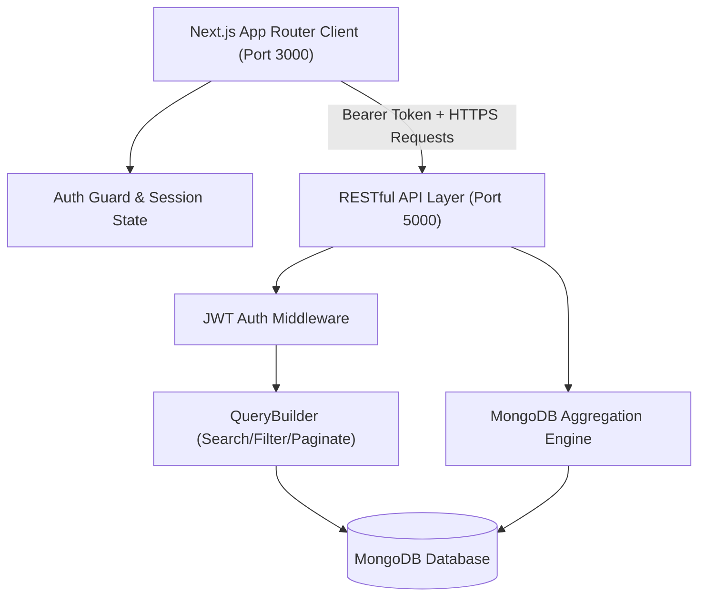

# Doctor Tracker — Clinical Operations & Patient Management Portal

An ultra-modern, secure administrative healthcare platform designed for hospital administrators to seamlessly oversee medical specialists, monitor patient admissions, and derive actionable clinical insights through real-time data visualization.

---

## 1. Description

**Doctor Tracker** is a secure, high-performance administrative web application engineered for modern healthcare institutions to manage doctors and their corresponding patient cohorts with maximum operational efficiency. By leveraging MongoDB compound indexing, multi-stage aggregation pipelines, and a glassmorphic Next.js interface, the system eliminates administrative bottlenecks, enabling instantaneous specialist lookups, granular patient tracking across diagnostic stages, and interactive workload analytics.

---

## 2. Setup Guide

Follow these steps to run both backend and frontend applications locally.

### Prerequisites
- **Node.js**: v18.0.0 or higher (v20+ recommended)
- **npm** or **yarn** / **pnpm**
- **MongoDB**: Local instance or MongoDB Atlas cluster connection

---

### Step 1: Backend Setup

1. Open your terminal and navigate to the backend directory:
   ```bash
   cd backend
   ```

2. Install dependencies:
   ```bash
   npm install
   ```

3. Configure Environment Variables:
   Copy `.env.example` to `.env`:
   ```bash
   cp .env.example .env
   ```
   *Sample `.env` contents:*
   ```env
   NODE_ENV=development
   PORT=5000
   DATABASE_URL=mongodb+srv://<username>:<password>@cluster0.efkzylz.mongodb.net/careguide?appName=Cluster0
   JWT_SECRET=kjfdafjadlfjasldfjldasfjldasffdkshfsdfufbbe
   SALT_ROUND=10
   ```

4. Run the backend development server:
   ```bash
   npm run dev
   ```
   *The server starts on `http://localhost:5000` and automatically provisions the Super Admin credentials (`admin@gmail.com` / `admin1234`).*

---

### Step 2: Frontend Setup

1. Open a new terminal and navigate to the frontend directory:
   ```bash
   cd frontend
   ```

2. Install dependencies:
   ```bash
   npm install
   ```

3. Configure Environment Variables:
   Copy `.env.example` to `.env.local`:
   ```bash
   cp .env.example .env.local
   ```
   *Sample `.env.local` contents:*
   ```env
   NEXT_PUBLIC_API_URL=http://localhost:5000/api/v1
   ```

4. Start the Next.js development server:
   ```bash
   npm run dev
   ```
   *The client application will be accessible at `http://localhost:3000`.*

---

## 3. System Architecture

The project employs a decoupled client-server architecture communicating over standard RESTful HTTP endpoints:



### Data Flow & Component Interaction:
1. **Authentication Flow**: The user signs in via `/login` with credentials. The backend verifies passwords with `bcrypt`, signs a JWT token with role claims, and returns it. The client stores the token in `localStorage`, and all subsequent requests transmit `Authorization: <token>`.
2. **Query Processing Flow**: Requests to `/api/v1/doctors` or `/api/v1/patients` pass through `QueryBuilder`, which concurrently executes case-insensitive `$regex` full-text search, multi-condition matching (specialization, hospital, status, date-wise ranges), and pagination skips.
3. **Analytics Aggregation Flow**: The `/api/v1/analytics/dashboard` endpoint dispatches parallel MongoDB aggregation pipelines (`$group`, `$lookup`, `$facet`, `$dateToString`) to calculate workload ratios, admission trends, and condition distribution without heavy JavaScript overhead.

---

## 4. Technical Decisions

### Decision 1: MongoDB Aggregation Pipelines vs. In-Memory Calculation for Clinical Analytics
* **Context**: The dashboard requires computing total counts, average patients per doctor, date-based admission trends by month, specialization distributions, and top doctor workloads.
* **Alternative Considered**: Querying all raw doctor and patient documents into Node.js memory and using JavaScript `.reduce()` / `.filter()` / `.map()` to calculate metrics.
* **Why Aggregation Won**:
  1. **Database-Level Performance**: MongoDB executes `$group`, `$sort`, and `$lookup` directly in C++ database engine routines, utilizing indexes (`admissionDate: -1`, `doctor: 1`, `status: 1`).
  2. **Network Bandwidth Optimization**: Fetching raw data for thousands of patients transfers megabytes of JSON over the wire. The aggregation pipeline reduces thousands of documents to a lightweight `< 2KB` payload before transmission.
  3. **Scalability**: As the hospital registry expands to tens of thousands of records, in-memory Node.js processing risks heap allocation exhaustion, while aggregation pipelines stream and paginate seamlessly.

### Decision 2: Decoupled Express + Next.js App Router with Centralized Auth Context over Single-Tier monolith
* **Context**: Requirement specifies a separate Next.js client application and a standalone Express backend server communicating over REST.
* **Alternative Considered**: Running all backend logic inside Next.js API Routes (`app/api/*`).
* **Why Decoupled Architecture Won**:
  1. **Independent Scalability & Microservice Readiness**: The Express API can be deployed, scaled, or placed behind an API gateway independently of the static/SSR frontend assets.
  2. **Standardized Middleware Pipeline**: Express allows clean re-use of battle-tested middlewares (`cors`, `express.json({ limit })`, custom `catchAsync`, `globalErrorHandler`, and Zod request validation).
  3. **Client Session Decoupling**: Centralized `AuthContext` with route guarding ensures instantaneous client-side navigation transitions without redundant full-page reloads.

---

## 5. Visual Evidence & Features Matrix

| Module | Core Features Implemented | Status |
| :--- | :--- | :---: |
| **Authentication** | JWT login, route protection, token validation, 1-Click Demo Login | ✅ Complete |
| **Dashboard** | 4 KPI Cards, SVG Monthly Admission Area Chart, Status Ring, Workload Bars | ✅ Complete |
| **Doctor Management** | Create doctor, search, date filter, specialization & hospital filters, pagination | ✅ Complete |
| **Doctor's Patients** | View patients under doctor, add patient under doctor, delete patient from doctor | ✅ Complete |
| **Patient Management**| Dedicated Patient Page, full search, diagnosis filter, status & doctor filters, CRUD | ✅ Complete |
| **UI Aesthetics** | Dark slate medical theme, glassmorphism cards, glowing pulse indicators | ✅ Complete |
| **Data Seeder** | 1-Click "Seed Sample Data" utility for instant demo population | ✅ Complete |

---

## 6. Default Credentials

For evaluation and testing:
- **Email**: `admin@gmail.com`
- **Password**: `admin1234`
- **Role**: `admin`
- *(Tip: Click the **"One-Click Admin Demo Login"** button on `/login` to auto-fill and authenticate instantly).*
